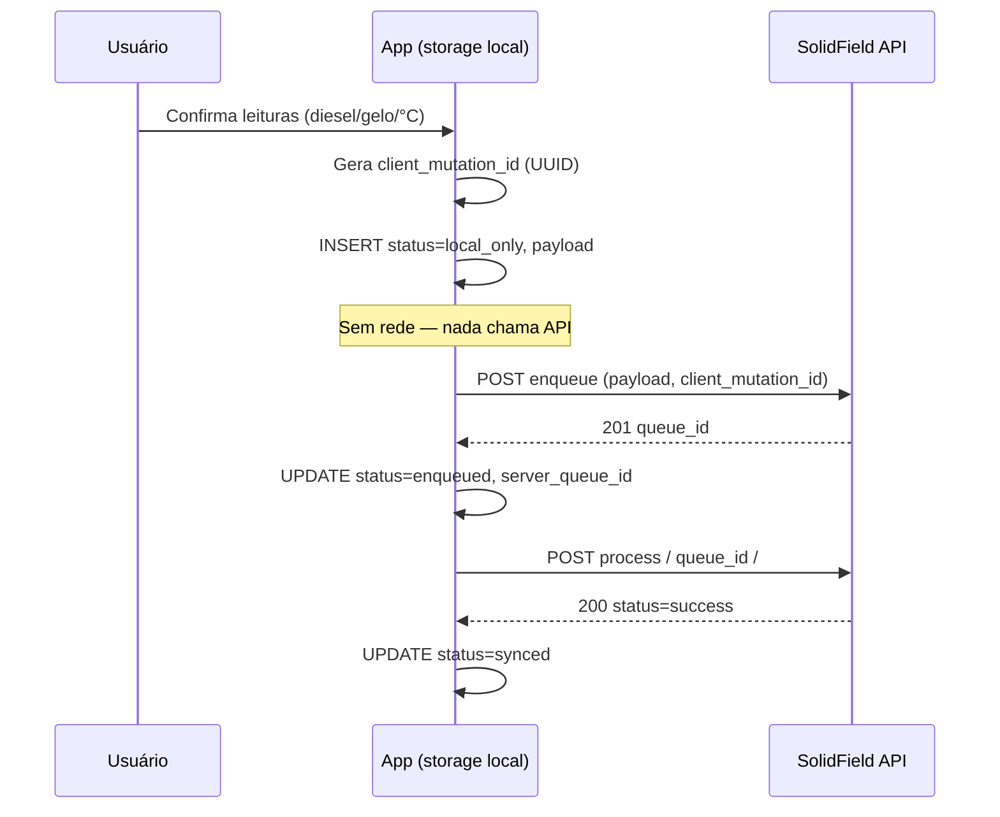

# Esquematização: gravação local → enqueue → process

Este documento define um **padrão de referência** para o **cliente** (app mobile / PWA) trabalhar **100% offline** no preenchimento e, ao reconectar, alinhar com a fila já existente no backend (`OfflineSyncQueue`).

Stack **Vue 3 + Ionic + Capacitor:** ver **`CAPACITOR_VUE_IONIC_OFFLINE_SYNC.md`** (pastas sugeridas, plugins, composable, eventos de rede/app).

O Django **não grava no dispositivo**; ele apenas expõe as APIs descritas em `OFFLINE_SYNC_QUEUE.md`. Toda a camada “local” abaixo é **responsabilidade do app**.

---

## 1. Princípios

| Princípio | Significado |
|-----------|-------------|
| **Um `client_mutation_id` por intenção** | UUID v4 gerado **no dispositivo** no momento da ação do usuário (ex.: “salvar turno”). Nunca reutilizar. |
| **Append-only local até confirmar** | Preferir **novo registro** local por tentativa lógica; evitar sobrescrever silenciosamente. |
| **Servidor é fonte da verdade para `queue_id`** | O `id` numérico de `OfflineSyncQueue` só existe após `enqueue` bem-sucedido. |
| **Process idempotente no servidor** | Após `success`, repetir `process` no mesmo item não reaplica mutação (ver serviço). |

---

## 2. Modelo mental de dados no dispositivo

Cada **mutação pendente** é uma linha (ou documento) com campos mínimos sugeridos:

| Campo | Tipo | Descrição |
|-------|------|-----------|
| `local_id` | string (UUID) | PK local; pode ser igual ao `client_mutation_id` ou separado. |
| `client_mutation_id` | string (UUID) | **Igual** ao enviado no `enqueue`; usado para idempotência no servidor. |
| `status` | enum | Ver seção 3. |
| `payload` | objeto JSON | Mesmo contrato do backend: `schema_version`, `action`, `body`. |
| `server_queue_id` | int \| null | Preenchido após `enqueue` 201. |
| `last_error_codes` | string[] \| null | Cópia de `codes` da última resposta HTTP ou de `payload.sync_error_codes` após `process` em conflito. |
| `created_at` | ISO datetime | Quando o usuário “confirmou” offline. |
| `updated_at` | ISO datetime | Última tentativa de sync. |

**Onde gravar:** SQLite (React Native / Flutter), IndexedDB (PWA), CoreData, etc. “Arquivo JSON” serve para protótipo, não é ideal para concorrência e busca.

---

## 3. Máquina de estados (lado cliente)

```text
                    ┌─────────────────┐
                    │  local_only     │  mutação criada offline, ainda não enviada
                    └────────┬────────┘
                             │ HTTP: POST enqueue_offline_sync_api
              ┌──────────────┼──────────────┐
              ▼              ▼              ▼
        (falha rede)   (201 + queue_id)  (422: ex. permissão)
              │              │              │
              ▼              ▼              ▼
     continua local_only   enqueued      local_failed (*)
              │              │
              │              │ HTTP: POST process_offline_sync_api/<id>
              │     ┌────────┴────────┐
              │     ▼                 ▼
              │  success          conflict
              │     │                 │
              │     ▼                 ▼
              │  synced          needs_retry (**)
```

- (*) `local_failed`: operador pode corrigir payload ou permissões; opcionalmente `status=dead` após N tentativas.
- (**) `needs_retry`: manter `server_queue_id`, chamar `process` de novo (o backend re-tenta `conflict` → `pending` internamente). Inspecionar `payload.sync_error_codes` retornado em `list` ou após 422.

---

## 4. Sequência recomendada (diagrama)



**Variação:** se houver rede e você quiser menos uma ida, pode chamar as APIs **diretas** de checklist (`create_checklist_item_answer_api`, etc.) **sem** passar pela fila; a fila é útil para **rastreio**, **retry unificado** e **mesmo contrato** para várias ações.

---

## 5. Contrato de `payload` (igual ao servidor)

O objeto salvo localmente deve ser o **mesmo** que será enviado em `enqueue.payload`:

```json
{
  "schema_version": 1,
  "action": "checklist_batch_answers",
  "body": {
    "checklist_id": 123,
    "answers": [
      { "item_template": 10, "value": 120.5, "note": "" }
    ]
  }
}
```

Para fechar o turno no servidor após os lotes:

```json
{
  "schema_version": 1,
  "action": "checklist_submit",
  "body": { "checklist_id": 123 }
}
```

Ordem sugerida no sync: **primeiro** todos os `checklist_batch_answers` pendentes daquele checklist, **depois** um único `checklist_submit`.

---

## 6. Política de sync (pseudo-algoritmo)

```text
função sincronizar():
  para cada registro onde status em (local_only, enqueued, needs_retry):
    se status == local_only OU server_queue_id is null:
      resposta = POST enqueue(payload, client_mutation_id)
      se sucesso: gravar server_queue_id, status = enqueued
      se 422 com conflict_retry_use_process: buscar queue_id existente (list API ou guardado) e status = enqueued
      se falha rede: break (tentar depois)

    se server_queue_id presente e status != synced:
      resposta = POST process(server_queue_id)
      se 200 e status success no JSON: status = synced
      se 422: copiar codes em last_error_codes; status = needs_retry
```

Use **backoff exponencial** entre tentativas (ex.: 30s, 2m, 10m) para não derrubar a API.

---

## 7. Relação com checklist / viagem

1. **Criar checklist** (template + `work_order`) idealmente **com rede uma vez** (porto), para existir `checklist_id` estável.
2. Offline: o app só acumula **respostas** (`checklist_batch_answers`) + eventual **submit** usando esse `checklist_id` fixo no `payload`.
3. Se no futuro existir ação `checklist_create` na fila offline no servidor, o fluxo local seria o mesmo: `local_only` → enqueue → process.

---

## 8. Checklist de implementação no app

- [ ] Escolher storage (SQLite / IndexedDB).
- [ ] Gerar e persistir `client_mutation_id` por ação de usuário.
- [ ] Worker de sync disparado por `online` event + timer.
- [ ] Mapear erros HTTP → `last_error_codes` e UI para técnico.
- [ ] Teste: modo avião → N mutações → rede → todas `synced`.

---

## 9. Documentos relacionados

- `OFFLINE_SYNC_QUEUE.md` — modelo, permissões e rotas HTTP no backend.
- `offline_sync_service.py` — regras de idempotência e ações suportadas no `process`.
