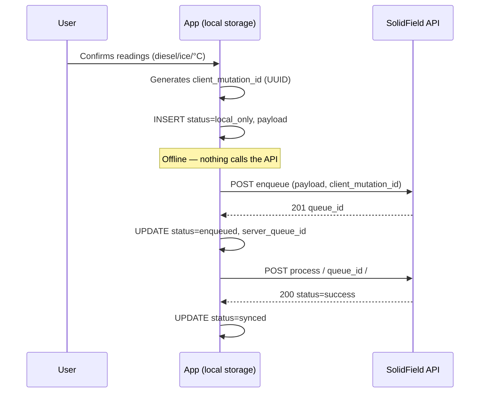

# Schema: local write → enqueue → process

This document defines a **reference pattern** for the **client** (mobile app / PWA) to work **fully offline** while filling data and, on reconnect, align with the queue that already exists on the backend (`OfflineSyncQueue`).

**Vue 3 + Ionic + Capacitor** stack: see **`CAPACITOR_VUE_IONIC_OFFLINE_SYNC.md`** (suggested folders, plugins, composable, network/app events).

Django **does not write to the device**; it only exposes the APIs described in `OFFLINE_SYNC_QUEUE.md`. The entire “local” layer below is the **app’s responsibility**.

---

## 1. Principles

| Principle | Meaning |
|-----------|---------|
| **One `client_mutation_id` per intent** | UUID v4 generated **on the device** at the moment of the user action (for example “save shift”). Never reuse it. |
| **Local append-only until confirmation** | Prefer a **new local record** per logical attempt; avoid silent overwrites. |
| **The server is the source of truth for `queue_id`** | The numeric `id` of `OfflineSyncQueue` exists only after a successful `enqueue`. |
| **Idempotent process on the server** | After `success`, repeating `process` on the same item does not reapply the mutation (see the service). |

---

## 2. Mental data model on the device

Each **pending mutation** is a row (or document) with these suggested minimum fields:

| Field | Type | Description |
|-------|------|-------------|
| `local_id` | string (UUID) | Local PK; may equal `client_mutation_id` or be separate. |
| `client_mutation_id` | string (UUID) | **Same** value sent on `enqueue`; used for server idempotency. |
| `status` | enum | See section 3. |
| `payload` | JSON object | Same backend contract: `schema_version`, `action`, `body`. |
| `server_queue_id` | int \| null | Set after `enqueue` 201. |
| `last_error_codes` | string[] \| null | Copy of `codes` from the last HTTP response, or of `payload.sync_error_codes` after `process` hits a conflict. |
| `created_at` | ISO datetime | When the user “confirmed” offline. |
| `updated_at` | ISO datetime | Last sync attempt. |

**Where to store it:** SQLite (React Native / Flutter), IndexedDB (PWA), CoreData, and so on. A “JSON file” is fine for a prototype; it is a poor fit for concurrency and lookup.

---

## 3. State machine (client side)

```text
                    ┌─────────────────┐
                    │  local_only     │  mutation created offline, not sent yet
                    └────────┬────────┘
                             │ HTTP: POST enqueue_offline_sync_api
              ┌──────────────┼──────────────┐
              ▼              ▼              ▼
        (network failure) (201 + queue_id) (422: e.g. permission)
              │              │              │
              ▼              ▼              ▼
     stays local_only     enqueued      local_failed (*)
              │              │
              │              │ HTTP: POST process_offline_sync_api/<id>
              │     ┌────────┴────────┐
              │     ▼                 ▼
              │  success          conflict
              │     │                 │
              │     ▼                 ▼
              │  synced          needs_retry (**)
```

- (*) `local_failed`: the operator can fix the payload or permissions; optionally `status=dead` after N attempts.
- (**) `needs_retry`: keep `server_queue_id` and call `process` again (the backend retries `conflict` → `pending` internally). Inspect `payload.sync_error_codes` returned by `list` or after 422.

---

## 4. Recommended sequence (diagram)



**Variation:** if the network is up and you want one fewer round trip, you can call the checklist APIs **directly** (`create_checklist_item_answer_api`, and so on) **without** going through the queue; the queue is useful for **tracking**, **unified retry**, and the **same contract** across several actions.

---

## 5. `payload` contract (same as the server)

The object stored locally must be the **same** object sent in `enqueue.payload`:

```json
{
  "schema_version": 1,
  "action": "checklist_batch_answers",
  "body": {
    "checklist_id": 123,
    "answers": [
      { "item_template": 10, "value": 120.5, "note": "" }
    ]
  }
}
```

To close the shift on the server after the batches:

```json
{
  "schema_version": 1,
  "action": "checklist_submit",
  "body": { "checklist_id": 123 }
}
```

Suggested sync order: **first** every pending `checklist_batch_answers` for that checklist, **then** a single `checklist_submit`.

---

## 6. Sync policy (pseudo-algorithm)

```text
function synchronize():
  for each record where status in (local_only, enqueued, needs_retry):
    if status == local_only OR server_queue_id is null:
      response = POST enqueue(payload, client_mutation_id)
      if success: store server_queue_id, status = enqueued
      if 422 with conflict_retry_use_process: look up the existing queue_id (list API or stored) and status = enqueued
      if network failure: break (try later)

    if server_queue_id is present and status != synced:
      response = POST process(server_queue_id)
      if 200 and status success in the JSON: status = synced
      if 422: copy codes into last_error_codes; status = needs_retry
```

Use **exponential backoff** between attempts (for example 30s, 2m, 10m) so the API is not overwhelmed.

---

## 7. Relationship to checklist / voyage

1. **Create the checklist** (template + `work_order`) ideally **once, online** (at port), so a stable `checklist_id` exists.
2. Offline: the app only accumulates **answers** (`checklist_batch_answers`) plus an eventual **submit**, using that fixed `checklist_id` in the `payload`.
3. If a `checklist_create` action is added to the server offline queue later, the local flow stays the same: `local_only` → enqueue → process.

---

## 8. App implementation checklist

- [ ] Choose storage (SQLite / IndexedDB).
- [ ] Generate and persist a `client_mutation_id` per user action.
- [ ] Sync worker triggered by the `online` event plus a timer.
- [ ] Map HTTP errors to `last_error_codes` and a technician UI.
- [ ] Test: airplane mode → N mutations → network → all `synced`.

---

## 9. Related documents

- `OFFLINE_SYNC_QUEUE.md` — model, permissions, and HTTP routes on the backend.
- `offline_sync_service.py` — idempotency rules and actions supported by `process`.
